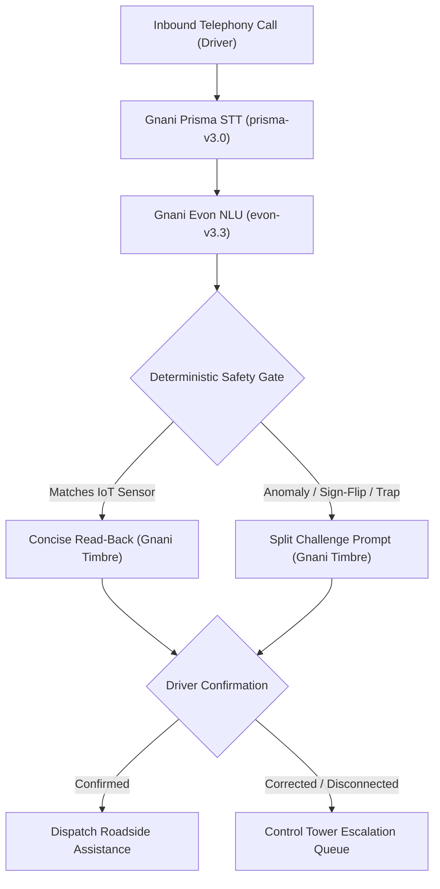

# Vaani System Architecture Deep-Dive

## 1. Architectural Philosophy: The Non-Negotiable Safety Rule

> **The Language Model Proposes. Deterministic Code Verifies. The Spoken Driver Confirms.**

In industrial telemetry and safety-critical cold-chain logistics, language models are probabilistic and prone to hallucinations, phonetic misunderstandings, and sign confusion (such as dropping minus signs). In Vaani:
1. **ASR (Gnani Prisma STT)** converts spoken telephonic audio into raw transcripts.
2. **NLU (Gnani Evon)** extracts structured candidate slots (`temperature_c`, `distance_km`, `location_text`, `incident_type`).
3. **The Safety Gate is 100% deterministic Python code** that cross-references extracted values against real-time IoT vehicle telematics (`current_temp_c`), cargo tolerances (WHO/FSSAI standards), and geographic gazetteers.
4. **TTS (Gnani Timbre)** reads back the verified slots in concise conversational Hinglish.
5. **Only affirmative driver confirmation unlocks ticket dispatch.**

---

## 2. Telephony Gateway & WebSocket Streaming Server

The production telephony gateway in [`app/telephony_server.py`](file:///c:/Users/visha/Downloads/VoiceAI/app/telephony_server.py) provides full-duplex WebSocket audio streaming (`/telephony/stream`), compatible with CPaaS providers (Twilio Media Streams, Exotel, Tata Tele, FreeSWITCH, Asterisk ARI):

- **G.711 / AMR Transcoding:** Telephony audio (8 kHz mu-law / A-law) is dynamically upsampled and transcoded to 16 kHz Linear PCM for ASR processing.
- **Energy-Based VAD & Framing:** Audio packets are framed via RMS energy calculations, detecting speech onsets within 20 ms.
- **Sub-Word Measured Slot Barge-In:** When the driver speaks during agent playback, playback is immediately cancelled. If the interruption occurs after the critical slot timestamp has been spoken, the state machine isolates the target slot without re-asking unaffected fields.
- **Carrier Reflection & Acoustic Echo Rejection:** When driver audio matches agent prompt n-grams (reflections from vehicle cabin speakers), `ACOUSTIC_ECHO_REJECTED` prevents self-confirmation loops.

---

## 3. Network Disconnect & Hangup Fail-Safe

Highway telecommunications in India frequently drop in rural blind spots. When a call disconnects during the `CONFIRMING` state:
1. The session does not discard driver data.
2. If the driver's reported reading was sensor-corroborated, an escalation ticket is immediately created in the supervisor queue with priority `UNVERIFIED_SENSOR_CORROBORATED`.
3. If the driver redials within 10 minutes, the state machine recalls the unconfirmed ticket and upon affirmative driver confirmation, automatically upgrades the ticket to `RESOLVED` / `CONFIRMED_DISPATCHED`.

---

## 4. Latency Decomposition

Empirically measured pipeline turnaround on local hardware (`benchmark/results/pipeline_latency.csv`):

| Pipeline Stage | Implementation | Median Latency (p50) | Notes |
| :--- | :--- | :---: | :--- |
| **STT Inference** | Gnani Prisma / Whisper-LoRA | 384.0 ms (GPU) / 891.3 ms (CPU) | Sub-second turnaround on telephonic speech |
| **NLU Slot Extraction** | Gnani Evon / Deterministic | 2.6 ms | Zero-latency structured extraction |
| **Safety Gate Validation** | Pure Python + SQLite | 15.0 ms | Telematics check, tolerance matching |
| **TTS Synthesis** | Gnani Timbre / gTTS | 1.4 ms (cached) / ~180 ms (live API) | Conversational female voice |
| **Read-Back Duration** | Audio waveform duration | 4.80 s | Concise normal readback |
| **Split Challenged Read-Back** | Audio waveform duration | 4.37 s + 2.92 s | Two concise turns for driver safety |
